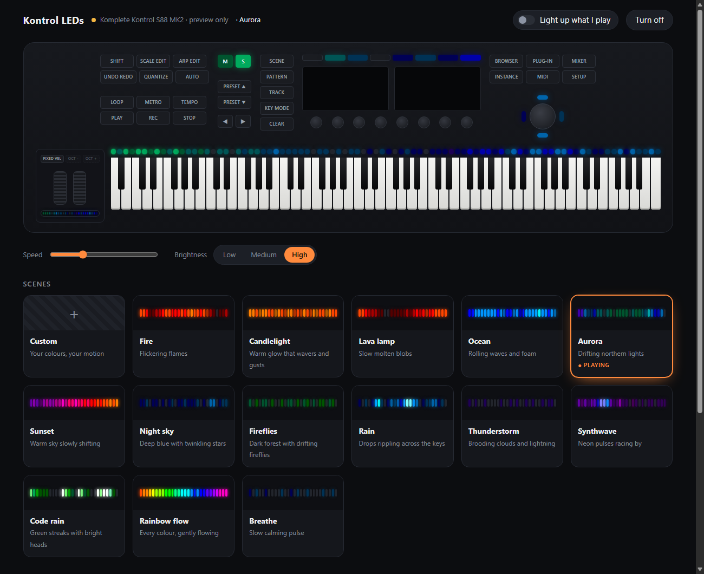

# Kontrol LEDs

Make your **Native Instruments Komplete Kontrol** keyboard glow: ambient scenes
like fire, ocean and aurora, your own colours on every key, a scale guide for
practising, and keys that light up as you play.



> Kontrol LEDs is a free hobby project. It is not made by or affiliated with
> Native Instruments.

## Get started

You don't need any technical knowledge.

1. **Download** `KontrolLEDs.exe` from the
   [latest release](https://github.com/eliasehmann/kontrol-leds/releases/latest).
2. **Plug in** your keyboard and switch it on.
3. **Double-click** `KontrolLEDs.exe`. The app opens in your web browser.
   - If Windows says *"Windows protected your PC"*, click **More info →
     Run anyway**. This appears because the app isn't signed by a big company,
     not because something is wrong.
4. **Pick a scene.** That's it.

The app keeps running in the **system tray**, the little icons next to the
clock. Right-click its keyboard icon to:

- **Open** the app again,
- **Turn lights off**,
- tick **Start with Windows**, so your lights come back every time you turn on
  your PC,
- **Quit**. This also turns the lights off.

Your last look is remembered, so the next start picks up where you left off.

## What you can do

| | |
|---|---|
| **Scenes** | 14 animated moods: Fire, Candlelight, Lava lamp, Ocean, Rain, Aurora, Night sky, Fireflies, Thunderstorm, Synthwave, Code rain, Sunset, Rainbow flow and Breathe. Each tile shows a live preview. Use **Speed** and **Brightness** to fine-tune them. |
| **Custom** | Pick your own colours and a motion (still, flow, waves, pulse, flicker or twinkle), then save it as your own scene. |
| **Paint your own** | Colour every key, every touch strip light and every button yourself, on a drawing of your keyboard. Save it as a look. |
| **Scale guide** | Choose a key and a scale (major, minor, pentatonic, blues…). Its notes light up, with the root notes in red. |
| **Light up what I play** | The switch at the top. The keys you press light up white, on top of whatever is showing, and stay lit while you hold the sustain pedal. |
| **Looks** | Ready-made static layouts and the ones you save. |

## Questions

**It says it can't find my keyboard.**
Check that the keyboard is plugged in and switched on. The app connects by
itself within a couple of seconds. If it still doesn't, quit the Komplete
Kontrol app and try again.

**My colours flicker or get replaced.**
The Komplete Kontrol app and your music software's keyboard integration also
control the lights. Close them while you use Kontrol LEDs.

**Some buttons only light up white.**
That's the keyboard's hardware: on the S88 MK2, only the keys, the touch strip,
M, S, the display buttons and the encoder arrows have coloured lights. The
drawing in the app shows exactly what the keyboard can do.

**"Light up what I play" can't hear my keyboard.**
Make sure no other program has taken the keyboard's MIDI input for itself.
Some music programs do that. Then flip the switch off and on.

**Do the lights stay on when I quit the app?**
Quitting turns them off. Closing only the browser tab doesn't: the app keeps
running in the tray.

## Supported keyboards

| Keyboard | Status |
|---|---|
| Komplete Kontrol **S88 MK2** | tested: keys, 42 buttons, touch strip |
| Komplete Kontrol S49 MK2, S61 MK2 | should work (same design as the S88), not tested yet |
| Komplete Kontrol S25 / S49 / S61 / S88 **MK1** | key lights only, not tested yet |

Runs on Windows 10 and 11 (tested on Windows 11). Got one of the untested
keyboards? Please tell us whether it works.

---

## For developers

Everything the app does is also available from Python and a command line
called `kkleds`. Support for each keyboard comes from **profiles**, JSON files
in `src/kkleds/profiles/`. To add a keyboard, you write a profile, not code: see
[docs/adding-a-device.md](docs/adding-a-device.md).

### Setup

```powershell
git clone https://github.com/eliasehmann/kontrol-leds.git
cd kontrol-leds
python -m venv .venv
.\.venv\Scripts\Activate.ps1
pip install -e ".[app,dev]"
python -m kkleds.app        # the app, from source
pytest
```

### Command line

```powershell
kkleds list                          # what's connected, and which profile it uses
kkleds ui                            # the app's page without the tray icon (--dry-run = no keyboard)
kkleds scene fire --speed 0.8        # play a scene (--list for all)
kkleds preset split-keyboard         # show a look (--list for all)
kkleds fill blue                     # colours: red, red:0-2, red:pastel, #ff8800, 0x2B
kkleds set A0-B2=blue C3-C8=green    # keys: all, white, black, C, C4, A0-C4, "C,E,G"
kkleds scale D dorian
kkleds buttons play=on display=blue  # --list for every name and group
kkleds strip rainbow
kkleds follow --velocity --sustain   # play-along without the app
kkleds devices                       # every known keyboard profile
```

`--dry-run` works with every command and draws the result in the terminal
instead of on the keyboard.

### Building the app

```powershell
.\scripts\build-windows.ps1          # runs the tests, then builds dist\KontrolLEDs.exe
```

### The website version

The same app also runs in the browser, with no install, over WebHID and
Web MIDI. Python runs inside the page via Pyodide.

```powershell
python webapp\build.py               # builds site\, a static site for any HTTPS host
```

See [docs/website.md](docs/website.md) for how it works, its limits and
hosting.

### How it works

- **USB:** the keyboard's lights are driven over USB HID. For the S MK2 there
  are three messages: an init, the light guide (one palette colour per key),
  and the buttons plus touch strip. Details:
  [docs/komplete-kontrol-s-mk2.md](docs/komplete-kontrol-s-mk2.md).
- **Smooth fades:** the S MK2 only has 3 brightness levels per colour, so
  scenes use dithering. In a fade, the keys move to the next level one by one
  instead of all jumping in steps.
- **Local only:** the app's page is served only to your own computer
  (127.0.0.1), and its API refuses requests that come from other websites.
- **Your files:** settings, saved looks and saved scenes live in `~/.kkleds/`.

| Module | What it does |
|---|---|
| `profile.py`, `profiles/*.json` | keyboard profiles: USB IDs, reports, button map, panel drawing |
| `encodings.py` | colour formats on the wire: palette, rgb, mono |
| `colors.py`, `notes.py` | NI palette, RGB, gradients; note names, scales, key selectors |
| `layout.py`, `buttons.py` | painting keys, buttons and the touch strip |
| `scenes.py`, `effects.py` | ambient scenes (with dithering) and simple animations |
| `engine.py` | keeps the keyboard connected and runs the current mode, play-along and settings |
| `api.py`, `webui.py`, `web/index.html` | the page, its API, and the local server the app uses |
| `browser.py`, `webapp/` | the website version: the engine in the browser over WebHID and Web MIDI |
| `app.py`, `autostart.py`, `icon.py` | the desktop app: tray icon, single instance, start with Windows |
| `device.py`, `midi.py`, `cli.py` | HID access, MIDI input, the `kkleds` command |
